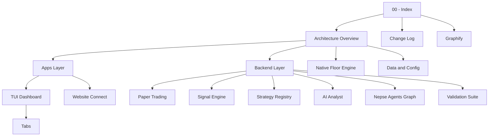

# NEPSE Quant Terminal — Vault Index

Keyboard-driven research and **paper-trading** terminal for the Nepal Stock Exchange. Local TUI plus optional [nepsequant.com](https://nepsequant.com) shared paper book, strategies, and AI analyst.

> [!warning] Paper only
> No broker connectivity. Virtual money only. Not financial advice. See [[Disclaimer]].

## Start here

- [[Architecture Overview]] — how the pieces fit
- [[Change Log]] — append every meaningful change here
- [[Graphify]] — code knowledge graph workflow for agents
- [[Decision Log]] — ADRs and irreversible choices

## Architecture

- [[Architecture Overview]]
- [[Apps Layer]] — TUI, CLI connect, MCP
- [[Backend Layer]] — trading, agents, backtests, market, quant_pro
- [[Native Floor Engine]] — optional Rust broker panels
- [[Data and Config]] — market DB, strategy registry, runtime state
- [[External Market Data Sources]] — bundled DB, Merolagani top-up, menaceXnadin cross-check
- [[Validation Suite]] — walk-forward, Monte Carlo, CSCV/PBO
- [[Baseline Backtest]] — C5 paper baseline methodology & status
- [[Backtest Reports]] — dated backtest run tracker & reports

## Components

- [[TUI Dashboard]]
- [[Paper Trading]]
- [[Signal Engine]]
- [[Strategy Registry]]
- [[AI Analyst]]
- [[Nepse Agents Graph]]
- [[News Sentiment Pipeline]]
- [[Website Connect]]
- [[Market Data Ingestion]]

## Tabs (keyboard `1`–`0`)

- [[Tab Market]] · [[Tab Portfolio]] · [[Tab Signals]] · [[Tab Lookup]] · [[Tab Agents]]
- [[Tab Orders]] · [[Tab Watchlist]] · [[Tab Rates]] · [[Tab Account]] · [[Tab Strategies]]

## Guides

- [[Quick Start]]
- [[Connect nepsequant.com]]
- [[AI Setup]]
- [[Developer Workflow]]
- [[Vault Conventions]]
- [[Obsidian CLI]]
- [[Disclaimer]]

## Project history

- [[Decision Log]]
- [[2026-11-19 - Vault and Graphify Bootstrap]]

## Map

