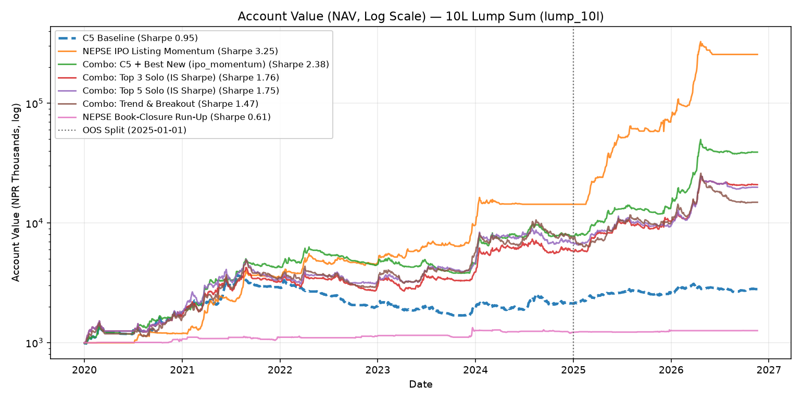
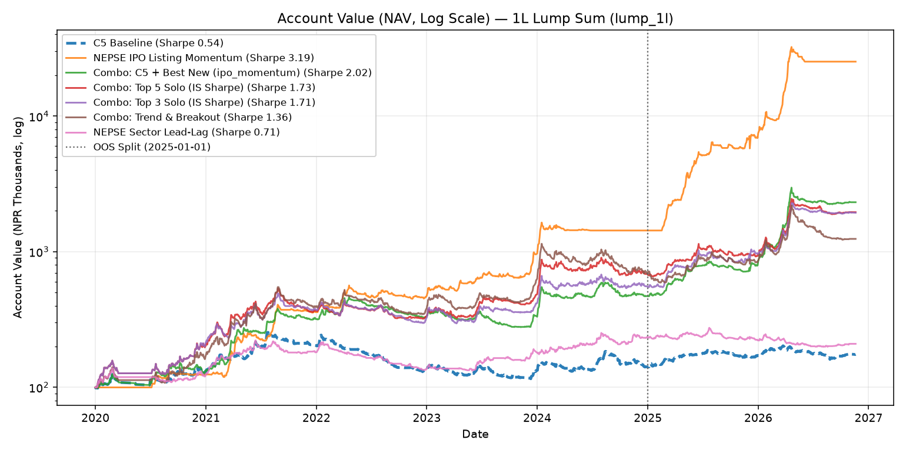
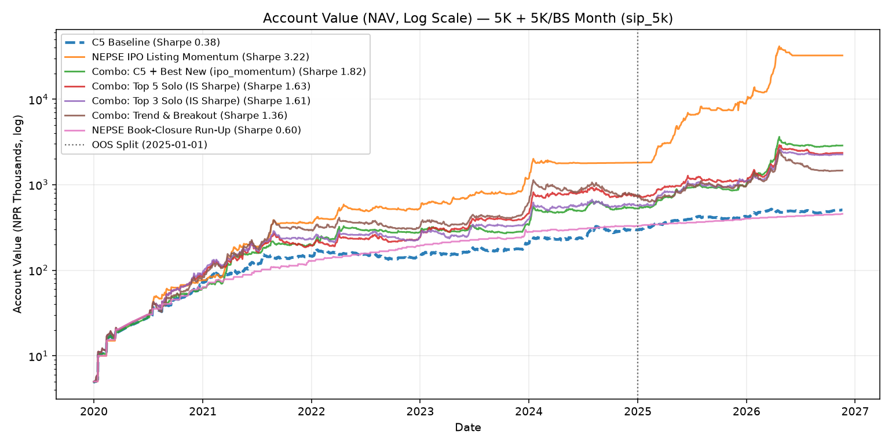

# NEPSE Strategy Comparison (2026-11-20 13:29)

- **Run folder:** `nqt-vault/Backtest Reports/2026-11-20_1329/`
- **Window:** `2020-01-01` → `2026-11-19`
- **Selection discipline:** Combination strategies (`combo_top3_sharpe`, `combo_top5_sharpe`, `combo_c5_plus_best`) were selected strictly from `2020-01-01..2024-12-31` solo Sharpe ratios. `2025-01-01` onward is reported separately as Out-of-Sample (OOS).
- **Engine rules:** Equal-weight sizing from current account NAV (cash + MTM holdings), no NPR 10K floor, 10-share minimum lot preserved, small-account position caps, realistic NEPSE fees including NPR 25 DP charge.
- **Trade persistence:** All runs, trades, daily NAV, and BS monthly deposits stored in `data/backtests.db`.

> [!warning] Execution realism caveat (`ipo_momentum` and combos containing it)
> Real NEPSE IPOs (e.g. `CGH`, `JBLB`, `MKCL`, `GMLI`, `NMIC`) frequently lock at the +10% upper circuit for 10–20 consecutive sessions with almost zero willing sellers. Because the base backtest engine fills T+1 open orders even on limit-locked sessions (`limit-locked days still fill`), `nepse_ipo_momentum` and combinations containing it (`combo_trend`, `combo_top3_sharpe`, `combo_top5_sharpe`, `combo_c5_plus_best`) overstate achievable live returns. Always inspect both the full ranking and the non-IPO strategies (`default_c5`, `nepse_book_closure_runup`, `nepse_lead_lag`, `nepse_calendar_festival`, `nepse_sector_rotation`).

## Strategies Beating C5 Baseline

**Consistently beat C5 Sharpe across all 3 capital scenarios (full window, >= 10 trades):**
- `nepse_ipo_momentum` (NEPSE IPO Listing Momentum)
- `combo_trend` (Combo: Trend & Breakout)
- `combo_top3_sharpe` (Combo: Top 3 Solo (IS Sharpe))
- `combo_top5_sharpe` (Combo: Top 5 Solo (IS Sharpe))
- `combo_c5_plus_best` (Combo: C5 + Best New (ipo_momentum))

| Strategy | Beats C5 Full-Window Sharpe | Beats C5 2025–2026 OOS Sharpe |
| --- | --- | --- |
| `nepse_ipo_momentum` (NEPSE IPO Listing Momentum) | lump_10l, lump_1l, sip_5k | lump_10l, lump_1l, sip_5k |
| `combo_top3_sharpe` (Combo: Top 3 Solo (IS Sharpe)) | lump_10l, lump_1l, sip_5k | lump_10l, lump_1l, sip_5k |
| `combo_top5_sharpe` (Combo: Top 5 Solo (IS Sharpe)) | lump_10l, lump_1l, sip_5k | lump_10l, lump_1l, sip_5k |
| `combo_c5_plus_best` (Combo: C5 + Best New (ipo_momentum)) | lump_10l, lump_1l, sip_5k | lump_10l, lump_1l, sip_5k |
| `combo_trend` (Combo: Trend & Breakout) | lump_10l, lump_1l, sip_5k | lump_10l, lump_1l |
| `nepse_book_closure_runup` (NEPSE Book-Closure Run-Up) | lump_1l, sip_5k | — |
| `nepse_sector_rotation` (NEPSE Sector Rotation) | lump_1l, sip_5k | — |
| `nepse_lead_lag` (NEPSE Sector Lead-Lag) | lump_1l, sip_5k | — |

## Scenario: `lump_10l` — 10L Lump Sum

| Rank | Strategy | Final NAV | Contributed | TWR CAGR | XIRR | Sharpe | Max DD | Trades | Fees % Inv | OOS CAGR (25-26) | OOS Sharpe |
| ---: | --- | ---: | ---: | ---: | ---: | ---: | ---: | ---: | ---: | ---: | ---: |
| 1 | [[2026-11-20_1329/NEPSE IPO Listing Momentum|NEPSE IPO Listing Momentum]] | NPR 254,904,417 | NPR 1,000,000 | +123.55% | +123.55% | 3.25 | -21.88% | 153 | 833.40% | +361.69% | 4.36 |
| 2 | [[2026-11-20_1329/Combo - C5 Plus Best New (ipo_momentum)|Combo: C5 + Best New (ipo_momentum)]] | NPR 38,996,430 | NPR 1,000,000 | +70.21% | +70.21% | 2.38 | -39.70% | 232 | 300.15% | +135.86% | 3.36 |
| 3 | [[2026-11-20_1329/Combo - Top 3 Solo (IS Sharpe)|Combo: Top 3 Solo (IS Sharpe)]] | NPR 20,877,784 | NPR 1,000,000 | +55.45% | +55.45% | 1.76 | -36.43% | 330 | 271.99% | +97.33% | 2.71 |
| 4 | [[2026-11-20_1329/Combo - Top 5 Solo (IS Sharpe)|Combo: Top 5 Solo (IS Sharpe)]] | NPR 19,857,234 | NPR 1,000,000 | +54.33% | +54.33% | 1.75 | -36.95% | 341 | 308.05% | +76.97% | 2.44 |
| 5 | [[2026-11-20_1329/Combo - Trend & Breakout|Combo: Trend & Breakout]] | NPR 14,884,752 | NPR 1,000,000 | +48.00% | +48.00% | 1.47 | -43.55% | 406 | 375.79% | +44.73% | 1.36 |
| 6 | **[[2026-11-20_1329/C5 Baseline (NAV Sizing)|C5 Baseline]]** | NPR 2,803,468 | NPR 1,000,000 | +16.14% | +16.14% | 0.95 | -54.62% | 196 | 70.70% | +15.79% | 1.26 |
| 7 | [[2026-11-20_1329/NEPSE Book-Closure Run-Up|NEPSE Book-Closure Run-Up]] | NPR 1,262,916 | NPR 1,000,000 | +3.45% | +3.45% | 0.61 | -10.23% | 84 | 16.50% | +1.76% | 0.57 |
| 8 | [[2026-11-20_1329/NEPSE Sector Lead-Lag|NEPSE Sector Lead-Lag]] | NPR 1,774,958 | NPR 1,000,000 | +8.69% | +8.69% | 0.61 | -31.74% | 253 | 72.27% | -12.22% | -0.99 |
| 9 | [[2026-11-20_1329/NEPSE Calendar & Festival Effects|NEPSE Calendar & Festival Effects]] | NPR 1,506,808 | NPR 1,000,000 | +6.13% | +6.13% | 0.60 | -20.17% | 72 | 16.94% | -0.64% | -0.05 |
| 10 | [[2026-11-20_1329/NEPSE Sector Rotation|NEPSE Sector Rotation]] | NPR 1,520,862 | NPR 1,000,000 | +6.28% | +6.28% | 0.40 | -43.48% | 254 | 81.93% | -16.09% | -0.92 |
| 11 | [[2026-11-20_1329/NEPSE Post-Earnings Drift|NEPSE Post-Earnings Drift]] | NPR 798,427 | NPR 1,000,000 | -3.22% | -3.22% | -0.14 | -53.31% | 136 | 23.65% | -6.13% | -0.55 |
| 12 | [[2026-11-20_1329/Combo - Event-Driven|Combo: Event-Driven]] | NPR 760,644 | NPR 1,000,000 | -3.89% | -3.89% | -0.18 | -59.67% | 223 | 41.75% | -9.27% | -1.11 |
| 13 | [[2026-11-20_1329/NEPSE Ex-Date Gap Rebound|NEPSE Ex-Date Gap Rebound]] | NPR 907,108 | NPR 1,000,000 | -1.41% | -1.41% | -0.25 | -27.62% | 47 | 7.46% | +1.74% | 0.42 |
| 14 | [[2026-11-20_1329/NEPSE Upper-Circuit Continuation|NEPSE Upper-Circuit Continuation]] | NPR 568,479 | NPR 1,000,000 | -7.87% | -7.87% | -0.28 | -65.40% | 395 | 71.71% | -39.66% | -2.83 |
| 15 | [[2026-11-20_1329/NEPSE NRB Monetary Policy|NEPSE NRB Monetary Policy]] | NPR 676,447 | NPR 1,000,000 | -5.52% | -5.52% | -0.85 | -32.36% | 34 | 4.81% | -2.99% | -0.48 |

## Scenario: `lump_1l` — 1L Lump Sum

| Rank | Strategy | Final NAV | Contributed | TWR CAGR | XIRR | Sharpe | Max DD | Trades | Fees % Inv | OOS CAGR (25-26) | OOS Sharpe |
| ---: | --- | ---: | ---: | ---: | ---: | ---: | ---: | ---: | ---: | ---: | ---: |
| 1 | [[2026-11-20_1329/NEPSE IPO Listing Momentum|NEPSE IPO Listing Momentum]] | NPR 25,194,448 | NPR 100,000 | +123.17% | +123.17% | 3.19 | -22.02% | 153 | 966.01% | +358.48% | 4.34 |
| 2 | [[2026-11-20_1329/Combo - C5 Plus Best New (ipo_momentum)|Combo: C5 + Best New (ipo_momentum)]] | NPR 2,317,084 | NPR 100,000 | +57.82% | +57.82% | 2.02 | -40.38% | 232 | 233.73% | +133.26% | 3.32 |
| 3 | [[2026-11-20_1329/Combo - Top 5 Solo (IS Sharpe)|Combo: Top 5 Solo (IS Sharpe)]] | NPR 1,957,361 | NPR 100,000 | +54.00% | +54.00% | 1.73 | -40.06% | 333 | 364.33% | +75.26% | 2.40 |
| 4 | [[2026-11-20_1329/Combo - Top 3 Solo (IS Sharpe)|Combo: Top 3 Solo (IS Sharpe)]] | NPR 1,937,775 | NPR 100,000 | +53.78% | +53.78% | 1.71 | -39.83% | 317 | 310.79% | +94.84% | 2.66 |
| 5 | [[2026-11-20_1329/Combo - Trend & Breakout|Combo: Trend & Breakout]] | NPR 1,243,739 | NPR 100,000 | +44.19% | +44.19% | 1.36 | -48.23% | 393 | 437.97% | +36.06% | 1.17 |
| 6 | [[2026-11-20_1329/NEPSE Sector Lead-Lag|NEPSE Sector Lead-Lag]] | NPR 209,578 | NPR 100,000 | +11.34% | +11.34% | 0.71 | -40.23% | 217 | 96.96% | -5.84% | -0.39 |
| 7 | [[2026-11-20_1329/NEPSE Book-Closure Run-Up|NEPSE Book-Closure Run-Up]] | NPR 129,596 | NPR 100,000 | +3.84% | +3.84% | 0.58 | -13.13% | 83 | 26.48% | +1.72% | 0.45 |
| 8 | [[2026-11-20_1329/NEPSE Sector Rotation|NEPSE Sector Rotation]] | NPR 200,737 | NPR 100,000 | +10.65% | +10.65% | 0.56 | -39.95% | 232 | 106.90% | -13.14% | -0.60 |
| 9 | **[[2026-11-20_1329/C5 Baseline (NAV Sizing)|C5 Baseline]]** | NPR 175,149 | NPR 100,000 | +8.48% | +8.48% | 0.54 | -54.54% | 171 | 68.17% | +12.12% | 0.88 |
| 10 | [[2026-11-20_1329/NEPSE Calendar & Festival Effects|NEPSE Calendar & Festival Effects]] | NPR 136,020 | NPR 100,000 | +4.57% | +4.57% | 0.43 | -24.84% | 65 | 22.28% | -0.98% | -0.06 |
| 11 | [[2026-11-20_1329/Combo - Event-Driven|Combo: Event-Driven]] | NPR 66,487 | NPR 100,000 | -5.75% | -5.75% | -0.23 | -66.72% | 194 | 64.38% | -16.36% | -1.43 |
| 12 | [[2026-11-20_1329/NEPSE Post-Earnings Drift|NEPSE Post-Earnings Drift]] | NPR 65,917 | NPR 100,000 | -5.87% | -5.87% | -0.26 | -60.27% | 104 | 32.33% | -11.69% | -1.08 |
| 13 | [[2026-11-20_1329/NEPSE Ex-Date Gap Rebound|NEPSE Ex-Date Gap Rebound]] | NPR 84,986 | NPR 100,000 | -2.33% | -2.33% | -0.27 | -38.40% | 44 | 13.27% | +2.52% | 0.40 |
| 14 | [[2026-11-20_1329/NEPSE Upper-Circuit Continuation|NEPSE Upper-Circuit Continuation]] | NPR 20,663 | NPR 100,000 | -20.46% | -20.46% | -0.71 | -86.04% | 326 | 94.23% | -56.33% | -2.76 |
| 15 | [[2026-11-20_1329/NEPSE NRB Monetary Policy|NEPSE NRB Monetary Policy]] | NPR 64,602 | NPR 100,000 | -6.15% | -6.15% | -0.79 | -35.40% | 23 | 6.58% | -2.30% | -0.23 |

## Scenario: `sip_5k` — 5K + 5K/BS Month

| Rank | Strategy | Final NAV | Contributed | TWR CAGR | XIRR | Sharpe | Max DD | Trades | Fees % Inv | OOS CAGR (25-26) | OOS Sharpe |
| ---: | --- | ---: | ---: | ---: | ---: | ---: | ---: | ---: | ---: | ---: | ---: |
| 1 | [[2026-11-20_1329/NEPSE IPO Listing Momentum|NEPSE IPO Listing Momentum]] | NPR 32,432,982 | NPR 415,000 | +133.09% | +144.87% | 3.22 | -22.01% | 153 | 289.33% | +358.87% | 4.35 |
| 2 | [[2026-11-20_1329/Combo - C5 Plus Best New (ipo_momentum)|Combo: C5 + Best New (ipo_momentum)]] | NPR 2,872,919 | NPR 415,000 | +50.89% | +57.21% | 1.82 | -38.61% | 211 | 57.81% | +133.20% | 3.32 |
| 3 | [[2026-11-20_1329/Combo - Top 5 Solo (IS Sharpe)|Combo: Top 5 Solo (IS Sharpe)]] | NPR 2,353,370 | NPR 415,000 | +53.57% | +51.01% | 1.63 | -41.83% | 303 | 83.81% | +77.03% | 2.45 |
| 4 | [[2026-11-20_1329/Combo - Top 3 Solo (IS Sharpe)|Combo: Top 3 Solo (IS Sharpe)]] | NPR 2,256,592 | NPR 415,000 | +52.32% | +49.72% | 1.61 | -44.41% | 291 | 70.37% | +97.11% | 2.71 |
| 5 | [[2026-11-20_1329/Combo - Trend & Breakout|Combo: Trend & Breakout]] | NPR 1,466,666 | NPR 415,000 | +45.19% | +36.72% | 1.36 | -48.15% | 371 | 104.30% | +36.10% | 1.17 |
| 6 | [[2026-11-20_1329/NEPSE Book-Closure Run-Up|NEPSE Book-Closure Run-Up]] | NPR 456,522 | NPR 415,000 | +3.76% | +2.77% | 0.60 | -10.36% | 82 | 9.21% | +1.66% | 0.54 |
| 7 | [[2026-11-20_1329/NEPSE Sector Rotation|NEPSE Sector Rotation]] | NPR 388,224 | NPR 415,000 | +9.96% | -1.95% | 0.52 | -41.74% | 222 | 29.89% | -14.77% | -0.78 |
| 8 | [[2026-11-20_1329/NEPSE Sector Lead-Lag|NEPSE Sector Lead-Lag]] | NPR 457,815 | NPR 415,000 | +6.95% | +2.86% | 0.48 | -40.27% | 213 | 28.46% | -10.17% | -0.82 |
| 9 | **[[2026-11-20_1329/C5 Baseline (NAV Sizing)|C5 Baseline]]** | NPR 507,799 | NPR 415,000 | +5.27% | +5.86% | 0.38 | -53.58% | 165 | 19.25% | +15.11% | 1.22 |
| 10 | [[2026-11-20_1329/NEPSE Calendar & Festival Effects|NEPSE Calendar & Festival Effects]] | NPR 435,334 | NPR 415,000 | +3.65% | +1.39% | 0.36 | -24.56% | 64 | 7.71% | -0.75% | -0.07 |
| 11 | [[2026-11-20_1329/NEPSE Post-Earnings Drift|NEPSE Post-Earnings Drift]] | NPR 335,007 | NPR 415,000 | -4.63% | -6.28% | -0.14 | -58.63% | 115 | 11.10% | -5.93% | -0.54 |
| 12 | [[2026-11-20_1329/Combo - Event-Driven|Combo: Event-Driven]] | NPR 313,720 | NPR 415,000 | -4.77% | -8.23% | -0.22 | -63.40% | 197 | 18.88% | -9.62% | -1.16 |
| 13 | [[2026-11-20_1329/NEPSE Ex-Date Gap Rebound|NEPSE Ex-Date Gap Rebound]] | NPR 399,573 | NPR 415,000 | -2.67% | -1.11% | -0.43 | -35.18% | 44 | 4.49% | +1.61% | 0.40 |
| 14 | [[2026-11-20_1329/NEPSE Upper-Circuit Continuation|NEPSE Upper-Circuit Continuation]] | NPR 213,372 | NPR 415,000 | -12.71% | -19.93% | -0.45 | -67.79% | 322 | 34.83% | -39.70% | -2.79 |
| 15 | [[2026-11-20_1329/NEPSE NRB Monetary Policy|NEPSE NRB Monetary Policy]] | NPR 343,594 | NPR 415,000 | -5.95% | -5.53% | -0.89 | -34.89% | 26 | 2.79% | -3.03% | -0.49 |

Related: [[Backtest Reports]], [[Strategy Catalog]], [[Backtesting Process]], [[Baseline Backtest]], [[Decision Log]].
