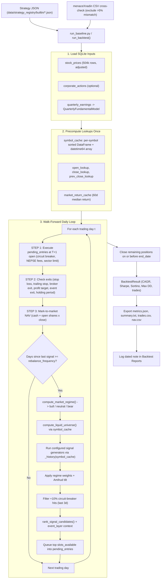

# Backtesting Process

End-to-end guide for running, profiling, and documenting paper backtests in NEPSE Quant Terminal.

- **Engine:** `backend/backtesting/simple_backtest.py` (`run_backtest`, `CAPITAL_SCENARIOS`)
- **Trade store:** `backend/backtesting/results_store.py` → `data/backtests.db` (`runs`, `trades`, `daily_nav`, `contributions`; gitignored)
- **Strategy configs:** `data/strategy_registry/builtin/*.json` (see [[Strategy Registry]], [[Strategy Catalog]])
- **Runners:** `scripts/validation/run_baseline.py` (C5 across 3 scenarios) · `scripts/validation/run_strategy_suite.py` (full parallel suite + vault reports)
- **Tests:** `tests/test_backtest_parity.py` · `tests/unit/test_capital_scenarios.py`

## Standard capital scenarios (mandatory)

Every backtest runs all three `CAPITAL_SCENARIOS` (enforced by `.cursor/rules/backtest-scenarios.mdc` and ADR-003 in [[Decision Log]]):

1. `lump_10l` — NPR 1,000,000 lump sum (NPR 0/month)
2. `lump_1l` — NPR 100,000 lump sum (NPR 0/month)
3. `sip_5k` — NPR 5,000 initial + NPR 5,000 on the first trading day of each Bikram Sambat (BS) month (`backend/quant_pro/nepal_calendar.py`)

**Sizing & metrics:**
- Equal-weight sizing from **current account NAV** (`nav / effective_max_positions`), not fixed `initial_capital`.
- Small-account position caps (`effective_max_positions_for_nav`: 1 under NPR 20K, 2 under 50K, 3 under 100K, 4 under 250K); no NPR 10K minimum floor, 10-share minimum lot preserved, full NEPSE fees including NPR 25 DP charge.
- Performance reported as both **Time-Weighted Return (TWR)** (CAGR, Sharpe, Sortino, Max DD unaffected by deposits) and **XIRR** (money-weighted return) plus `total_contributed` vs `final_nav`.
- Combination selection uses only `2020-01-01..2024-12-31` in-sample results; `2025-01-01+` is reported separately as out-of-sample (OOS).

## How to run

```bash
# 1. Ensure market DB is present and topped up (see External Market Data Sources)
.venv/bin/python setup_data.py
.venv/bin/python setup_data.py --scrape --days 230

# 2. Run C5 baseline across all 3 scenarios (writes data/backtests.db + data/runtime/baselines/<run_date>/)
.venv/bin/python scripts/validation/run_baseline.py --force

# 3. Run the full NEPSE strategy suite (parallel, skips unchanged runs in data/backtests.db)
.venv/bin/python scripts/validation/run_strategy_suite.py

# 4. Verify capital scenarios, XIRR, and no-lookahead tests
.venv/bin/pytest tests/unit/test_capital_scenarios.py
```

### Runtime outputs (gitignored)

`scripts/validation/run_baseline.py` writes four files into `data/runtime/baselines/<YYYY-MM-DD>/`:

- `summary.txt` — human-readable summary, NEPSE buy-and-hold comparison, excluded symbols
- `metrics.json` — full portfolio metrics, signal/exit breakdowns, cross-check table, caveats
- `trades.csv` — closed trade ledger (`symbol`, `signal_date`, `entry_date`, `exit_date`, fees, net P&L)
- `nav.csv` — daily mark-to-market NAV curve

Durable run summaries belong in [[Backtest Reports]], grouped by date and time under `nqt-vault/Backtest Reports/YYYY-MM-DD_HHMM/` (`Strategy Comparison.md`, `<Strategy>.md`, `charts/nav_<scenario>.png`).

## Execution pipeline



## Performance & profiling

### 2026-11-20 bottleneck fix

Profiling C5 over a 76-trading-day slice (`2023-01-01` → `2023-04-30`, 9 signal days) showed `542s` wall time, with `465s` (86%) spent in `prices_df["symbol"] == symbol` string comparisons across `504,616` rows (`11,851` calls):

| Hotspot | Before (`2023Q1`, 76d) | Root cause |
| --- | ---: | --- |
| `compute_liquid_universe` | `150.4s` | Scanned full `prices_df` per symbol on every signal day |
| `generate_quarterly_fundamental_signals_at_date` | `70.7s` | Same full-table mask per liquid symbol |
| `generate_xsec_momentum_signals_at_date` | `67.8s` | Same full-table mask per liquid symbol |
| `volume` / `quality` / `low_vol` / `mean_reversion` | `~55s` each | Fell back to full-table scan whenever `get_symbol_history` returned `None` (unlisted symbols before IPO date) |
| `is_circuit_breaker_hit` | `20.5s` | Scanned full `prices_df` per candidate signal |
| `load_event_adjustment_context` | `4.7s` (`~0.52s`/call) | Called `init_db()` → `_dedupe_stock_prices()` on every signal day |

**Fix applied:**

1. Added `_history(prices_df, symbol_cache, symbol, target_date, tail=..., strict_before=...)` in `backend/backtesting/simple_backtest.py` — when `symbol_cache` is provided, it slices the per-symbol sorted frame via `np.searchsorted` and **never** falls back to scanning `prices_df`.
2. Routed all signal generators, `compute_liquid_universe`, `is_circuit_breaker_hit`, `apply_amihud_tilt`, and price-fill helpers (`get_price_with_fill_date`, `get_price_on_or_before_date`, `get_prev_close`) through `symbol_cache`.
3. Guarded `init_db()` in `backend/quant_pro/event_layer.py` (`_ensure_event_db_initialized`) to run once per DB path per process.

### Before vs after

| Benchmark | Before | After | Speed-up |
| --- | ---: | ---: | ---: |
| C5 `2023-01-01` → `2023-04-30` (76d, parity fixture) | `489.45s` (`8m 09s`) | `17.75s` | **27.6×** |
| C5 full window `2020-01-01` → `2026-11-19` (1,557d) | `~5.5–6h` (`~11m` / 50d) | **`254.46s` (`4m 14s`)** (`~7.8s` / 50d) | **~80×** |

### Rule for new signal generators

Always accept `symbol_cache: Optional[Dict[str, Tuple[pd.DataFrame, np.ndarray]]] = None`, fetch per-symbol history through `_history(prices_df, symbol_cache, symbol, date, tail=...)`, and pass `symbol_cache=symbol_cache` from `run_backtest`. Never fall back to `prices_df[prices_df["symbol"] == symbol]` when `symbol_cache` is present — a `None` return means the symbol has no data on or before `date`.

## Caveats

- **No slippage:** fills use T+1 open (entries/intraday stops) or close (planned holding-period exit) with NEPSE tiered fees, but zero market impact.
- **Limit-locked fills:** circuit-locked sessions still fill at the circuit-clamped price.
- **Survivorship bias:** delisted tickers are absent from `stock_prices`.
- **In-sample parameters:** built-in C5 weights/thresholds were tuned on historical NEPSE data (see [[Disclaimer]]).

Related: [[Baseline Backtest]], [[Backtest Reports]], [[Signal Engine]], [[Validation Suite]], [[Strategy Registry]], [[External Market Data Sources]], [[00 - Index]].
